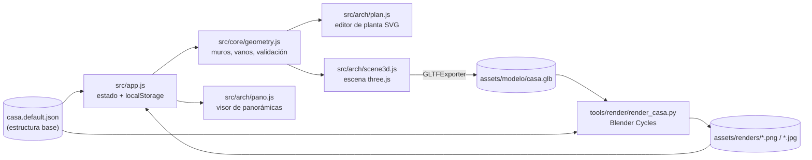

# Mi Casa 3D

Modelo 3D **paramétrico** de una casa, construido sobre un único archivo de datos
(`src/core/casa.default.json`, en adelante *casa.json*) del que salen todas las vistas: editor de planta en
SVG, visor 3D con three.js, visor de panorámicas y renders fotorrealistas con Blender Cycles. Es una app web
estática (HTML + módulos ES, sin paso de compilación) publicada con GitHub Pages en
<https://micasa.kerewes.com>.

El modelo es un borrador reconstruido a partir de panorámicas tomadas con el teléfono, sin planos ni cinta
métrica; cada cuarto lleva un nivel de `confidence` (`alta`, `media`, `baja`) que el editor muestra con la
opacidad del relleno.

## Funciones principales

- **Planta (SVG)**: mover y redimensionar cuartos con ajuste a 5 cm, deslizar puertas y ventanas por su muro,
  ubicar los puntos donde se tomó cada panorámica, inspector de propiedades (piso, cielo raso, color de
  muros, vanos, muebles), validación en vivo (traslapes, vanos fuera de su muro) y deshacer (Cmd/Ctrl+Z).
- **3D (three.js 0.169)**: materiales con texturas procedurales, vistas predefinidas (maqueta, sección a
  1.30 m, planta 3D), plano de corte de sección ajustable, capas (exteriores, puntos de foto, nombres,
  empotrados, muebles, techos) y recorrido a pie con colisiones (WASD o flechas).
- **Panorámicas**: proyección cilíndrica de las fotos del modo Panorama del teléfono. Solo funcionan en la
  copia local (las fotos no se publican, ver [Privacidad](#privacidad)).
- **Renders**: galería de imágenes generadas con Blender Cycles a partir del mismo modelo.
- **Datos**: copiar, importar y descargar *casa.json*; exportar el modelo a `.glb`; volver al borrador.
- **Cocina detallada** (`cocina/`): primera versión, independiente, de la cocina y el lavado con muebles,
  recorrido guiado y animación de construcción por fases.

## Arquitectura en breve



Detalle en [docs/ARCHITECTURE.md](docs/ARCHITECTURE.md).

## Inicio rápido

Requisitos: Python 3 (solo biblioteca estándar) y un navegador moderno con WebGL. three.js se carga desde
jsDelivr mediante un *import map*, así que el navegador necesita acceso a Internet.

```bash
python3 tools/serve.py          # puerto 5173 por defecto; python3 tools/serve.py 8080 para otro
```

Luego abrir <http://localhost:5173> (la cocina detallada en <http://localhost:5173/cocina/>). Hace falta
servir por HTTP porque los módulos ES no cargan desde `file://`. El servidor responde con
`Cache-Control: no-store` y escucha solo en `127.0.0.1`.

`index.html#3d` abre directamente en la pestaña 3D.

## Estructura del repositorio

```text
.
├── index.html                 # app principal: estilos, import map de three.js y maquetación
├── src/
│   ├── app.js                 # orquestación: estado, localStorage, inspector, 3D, panorámicas, renders
│   ├── core/
│   │   ├── casa.default.json  # estructura base (cuartos, vanos, muebles, exteriores, techos, panorámicas)
│   │   ├── geometry.js        # núcleo sin three.js: deriva muros, corta vanos, valida
│   │   └── fixtures.js        # catálogo de empotrados, muebles y elementos exteriores
│   ├── arch/
│   │   ├── plan.js            # editor de planta en SVG
│   │   ├── scene3d.js         # construye la escena three.js desde casa.json
│   │   └── pano.js            # visor de panorámicas cilíndricas
│   └── shared/textures.js     # texturas procedurales en canvas (pisos, madera, repello, zacate…)
├── cocina/                    # primera versión: cocina y lavado (app independiente)
├── assets/
│   ├── modelo/casa.glb        # modelo exportado desde la app (entrada del render)
│   └── renders/               # renders de Blender (PNG y JPG para la web)
├── tools/
│   ├── serve.py               # servidor de desarrollo sin caché + PUT /__save/ hacia assets/
│   ├── pano_period.py         # mide el periodo de 360° de cada panorámica (OpenCV)
│   └── render/render_casa.py  # render arquitectónico con Blender Cycles
├── tests/                     # pruebas (node:test y unittest)
├── docs/                      # arquitectura, especificación y pruebas
├── CNAME, .nojekyll           # GitHub Pages con dominio propio, sin Jekyll
└── .gitignore
```

## Coordenadas

En planta, `x` crece a la derecha visto desde la calle y `z` hacia el fondo del lote (`z = 0` es la fachada).
Todas las medidas en metros. En three.js el grupo de la casa usa `scale.z = -1` para no quedar en espejo
(`worldZ = -z`). En Blender, `X = x`, `Y = z` y `Z` es la altura.

## Configuración y archivos locales

No hay variables de entorno ni secretos. Archivos que **no** van a git (`.gitignore`):

| Ruta | Contenido | Nota |
|---|---|---|
| `photos/`, `panoramas/`, `panoramas-web/` | Fotos de referencia y panorámicas | Solo en la copia local |
| `tools/*.json` | Salida de `pano_period.py` | Regenerable |
| `assets/renders/*-preview.png` | Renders rápidos (`--preview`) | Regenerables |
| `.venv/`, `.claude/`, `.DS_Store` | Entorno y archivos del sistema | — |

Las ediciones hechas en el navegador se guardan en `localStorage` (clave `casa-json-v1`; la cocina usa
`cocina-lavado-layout-v1`). Para conservarlas en el repo hay que descargar o copiar *casa.json* y
reemplazar `src/core/casa.default.json`.

## Privacidad

`photos/`, `panoramas/` y `panoramas-web/` están en `.gitignore`: son fotos del interior de la casa y solo
se ven en la copia local. En el sitio publicado, abrir una panorámica muestra un aviso en lugar de la foto.
Para regenerar las versiones web de las panorámicas (macOS, `sips`):

```bash
mkdir -p panoramas-web && for f in panoramas/*.jpg; do sips -Z 8192 -s formatOptions 80 "$f" --out "panoramas-web/$(basename "$f")"; done
```

## Render arquitectónico (Blender Cycles)

1. Exportar el modelo a `assets/modelo/casa.glb`: con el servidor de desarrollo, desde la consola del
   navegador `window.__casa.exportGLB()` y `PUT /__save/modelo/casa.glb`; o con el botón «Descargar .glb».
2. Renderizar:

```bash
/Applications/Blender.app/Contents/MacOS/Blender -b --factory-startup -P tools/render/render_casa.py -- --samples 256 --res 1920x1080
```

`--shots fachada,aerea,maqueta,patio,sala,cocina,estudio` elige tomas y `--preview` hace una pasada rápida a
media resolución (máximo 48 muestras). El script ajusta materiales (vidrio con transmisión, metales, relieve
de repello y pisos, bisel de aristas), cambia los árboles esquemáticos por árboles orgánicos, agrega calle,
cielo físico, sol y una luz cálida por cuarto leída de *casa.json*. Usa GPU Metal si está disponible y si no
CPU. Las imágenes quedan en `assets/renders/` (PNG); la versión JPG para la web se genera aparte (el script
no la produce).

## Panorámicas: periodo de 360°

```bash
.venv/bin/python tools/pano_period.py panoramas/*.jpg   # requiere opencv-python y numpy en .venv
```

Escribe `tools/pano_period.json` con el periodo en píxeles y la focal del cilindro `f = P / 2π`. El visor
acepta `focal` y `sourceWidth` por panorámica; si no están, usa `f = alto de la imagen`.

## Pruebas

```bash
node --test 'tests/*.test.mjs'                      # núcleo geométrico (Node 22+)
.venv/bin/python -m unittest discover -s tests -v   # casa.json, pano_period.py y serve.py
```

Detalle en [docs/TESTING.md](docs/TESTING.md).

## Despliegue (GitHub Pages)

El sitio se publica desde la rama `main`, carpeta raíz, con el constructor clásico de GitHub Pages y HTTPS
obligatorio. `CNAME` fija el dominio propio y `.nojekyll` desactiva Jekyll para que se sirvan tal cual
todas las carpetas. No hay *workflow* de CI: **cada `git push` a `main` publica**. Lo que se ve en el sitio
es exactamente lo versionado: `casa.default.json`, `assets/modelo/casa.glb` y `assets/renders/*.jpg`.

Para publicar una nueva revisión de la planta: descargar *casa.json* desde la app, incrementar `revision`,
reemplazar `src/core/casa.default.json`, opcionalmente regenerar `casa.glb` y los renders, y hacer push. Los
visitantes con una copia guardada más vieja reciben la nueva revisión; la anterior queda respaldada en
`localStorage` (`casa-json-v1-respaldo-r<N>`) y se recupera con Deshacer.

## Documentación

- [docs/ARCHITECTURE.md](docs/ARCHITECTURE.md): componentes, flujos, despliegue y decisiones.
- [docs/SPEC.md](docs/SPEC.md): requisitos, esquema de *casa.json* y criterios de aceptación.
- [docs/TESTING.md](docs/TESTING.md): estrategia, suites y brechas.

## Estado y limitaciones

- Las medidas son estimadas desde fotos; la planta está en su revisión 6 (`revision` en *casa.json*).
- Los cuartos son rectángulos alineados a los ejes (con partes adicionales para formas en L); no hay muros
  diagonales ni curvos.
- La cocina detallada (`cocina/`) usa su propio modelo de medidas y no lee *casa.json*.
- El JPG de los renders y la copia de `casa.glb` a `assets/` son pasos manuales.
- Sin pruebas automatizadas de la interfaz ni del render (ver [docs/TESTING.md](docs/TESTING.md)).
