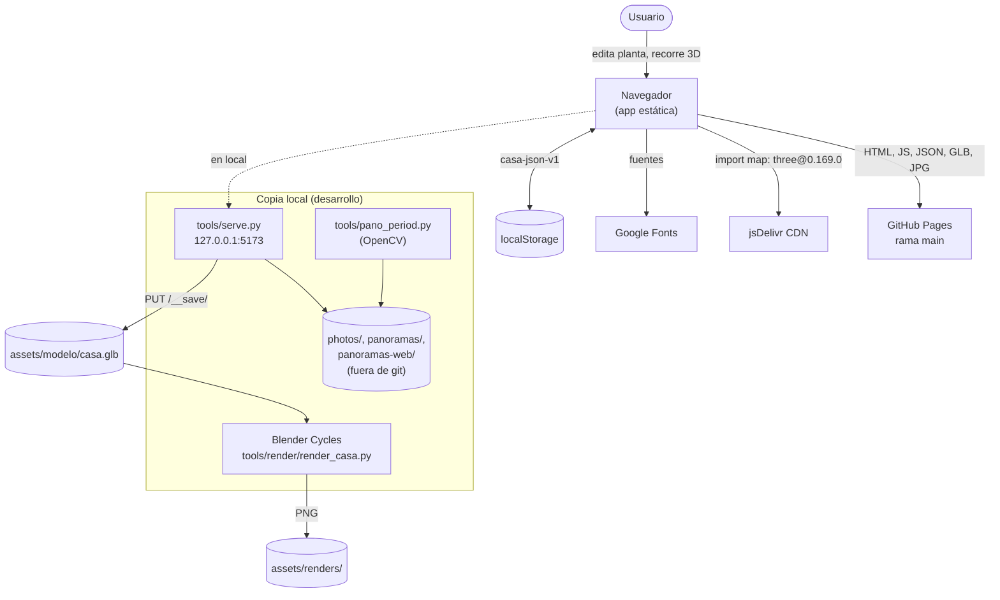
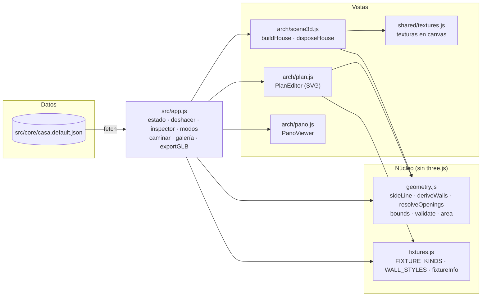
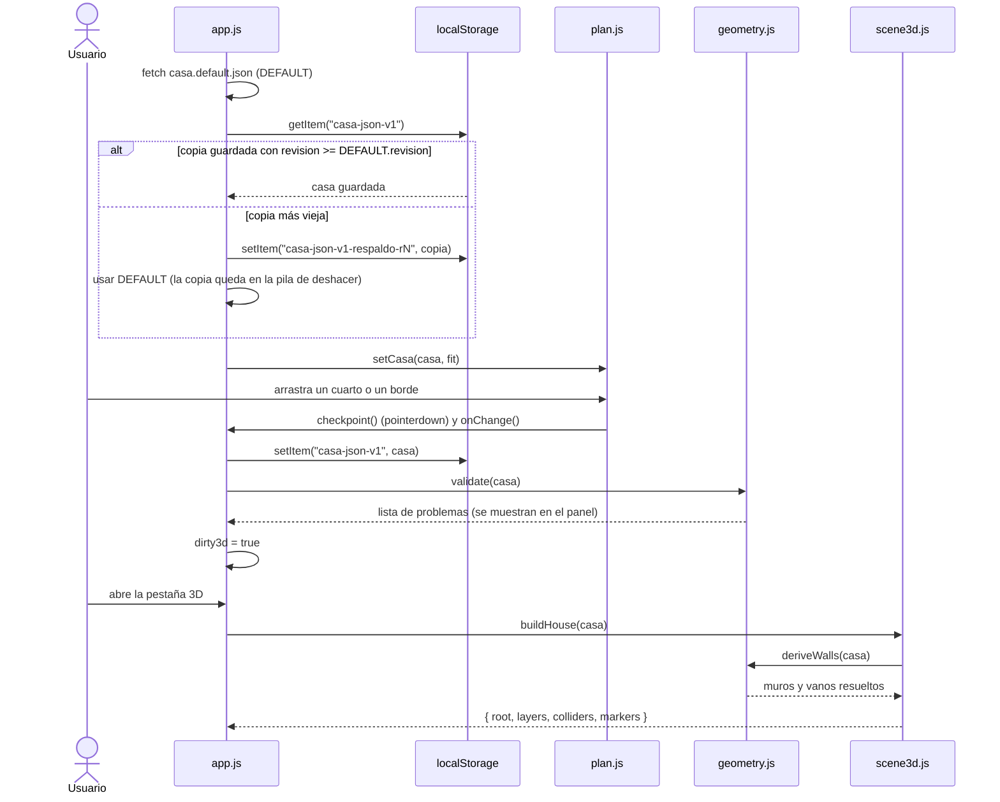
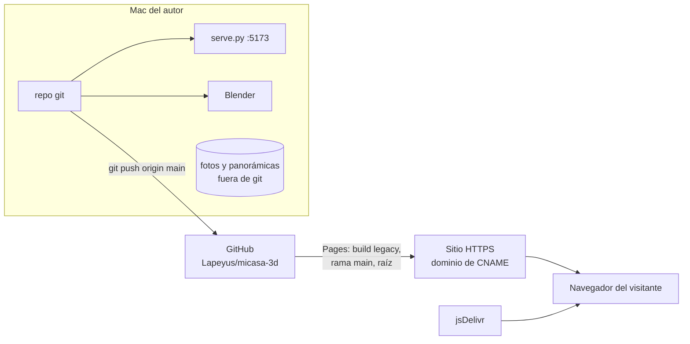

# Arquitectura

## 1. Contexto

Mi Casa 3D es una app web estática que corre por completo en el navegador. No tiene backend: la única
pieza de servidor es `tools/serve.py`, un servidor de desarrollo local. El render fotorrealista es un
proceso aparte, por lotes, en Blender.



Actores y sistemas externos:

| Actor / sistema | Papel |
|---|---|
| Usuario | Edita la planta, recorre el modelo, revisa panorámicas y renders. |
| GitHub Pages | Sirve el sitio publicado desde `main` (raíz) con dominio propio (`CNAME`). |
| jsDelivr | Entrega `three` y sus *addons* (`OrbitControls`, `RoomEnvironment`, `CSS2DRenderer`, `GLTFExporter`). |
| Google Fonts | Tipografías de la interfaz (Bricolage Grotesque, Instrument Sans, JetBrains Mono). |
| Blender (local) | Render por lotes desde `casa.glb` y *casa.json*. |
| OpenCV + NumPy (local, `.venv`) | Solo para `tools/pano_period.py`. |

## 2. Componentes



| Componente | Archivo | Responsabilidad |
|---|---|---|
| Estructura base | `src/core/casa.default.json` | Solo datos: cuartos, vanos, muebles, exteriores, techos y panorámicas. Esquema en [SPEC.md](SPEC.md). |
| Núcleo geométrico | `src/core/geometry.js` | Deriva muros como cajas alineadas a los ejes, reparte muros compartidos, corta vanos, calcula límites y áreas, y valida. No importa three.js, por eso se puede probar con Node. |
| Catálogo | `src/core/fixtures.js` | 30 tipos de empotrados, muebles y elementos exteriores, con capa, altura y profundidad por defecto. |
| Orquestador | `src/app.js` | Carga y guarda *casa.json* en `localStorage`, pila de deshacer (80 pasos), inspector de propiedades, modos (Planta, 3D, Panorámicas, Renders), recorrido a pie, exportación GLB y `window.__casa` para depurar. |
| Editor de planta | `src/arch/plan.js` | SVG con zoom, arrastre de cuartos y bordes (ajuste 0.05 m), vanos y puntos de foto. Al mover un cuarto arrastra sus partes, sus muebles y los puntos de foto de esa área. |
| Escena 3D | `src/arch/scene3d.js` | Construye un `THREE.Group` por capas (`floors`, `walls`, `openings`, `ceilings`, `outdoor`, `markers`, `empotrados`, `muebles`, `exterior`, `roofs`), colisionadores y marcadores. |
| Visor de panorámicas | `src/arch/pano.js` | Proyecta la foto dentro de un cilindro (arco = ancho / f) y limita el giro vertical a lo que cubre la foto. |
| Texturas | `src/shared/textures.js` | Texturas procedurales deterministas (semilla) para pisos, cielos, madera, repello, zacate, etc. |
| Cocina detallada | `cocina/` | App independiente con su propio modelo de medidas (`layout.js`), no comparte código con `src/`. |
| Servidor local | `tools/serve.py` | `SimpleHTTPRequestHandler` sin caché + `PUT /__save/<ruta>` que solo escribe dentro de `assets/`. |
| Render | `tools/render/render_casa.py` | Importa el GLB en Blender, ajusta materiales, agrega contexto (terreno, calle), luces y cámaras, y renderiza las tomas. |
| Periodo de panorámicas | `tools/pano_period.py` | Busca dónde se repite la imagen (plantillas sobre gradientes Sobel) para obtener la focal del cilindro. |

## 3. Flujos de datos

### 3.1 Carga y edición de la planta



### 3.2 Del modelo al render fotorrealista

```mermaid
sequenceDiagram
  actor U as Usuario
  participant A as app.js (navegador)
  participant SV as tools/serve.py
  participant BL as Blender + render_casa.py
  U->>A: window.__casa.exportGLB() o «Descargar .glb»
  A->>A: buildHouse(casa) sin marcadores, GLTFExporter (binario, texturas ≤ 2048)
  A->>SV: PUT /__save/modelo/casa.glb
  SV-->>A: 201 assets/modelo/casa.glb
  U->>BL: Blender -b -P tools/render/render_casa.py -- --shots ...
  loop por cada toma
    BL->>BL: reiniciar escena, Cycles (Metal o CPU)
    BL->>BL: importar casa.glb, ajustar materiales, árboles orgánicos
    BL->>BL: terreno, acera y calle; cielo físico y sol; luz por cuarto (casa.json)
    BL->>BL: ocultar techos y cielos si la toma es "cutaway"
    BL-->>U: assets/renders/<toma>.png (o <toma>-preview.png)
  end
  U->>U: convertir a JPG y hacer push (la galería lee assets/renders/<toma>.jpg)
```

### 3.3 Derivación de muros (núcleo)

`deriveWalls` recorre cada rectángulo (cuarto o parte) y cada lado (`S`, `N`, `W`, `E`):

1. Si el lado está en `room.open` (solo para la parte principal) no hay muro.
2. Busca rectángulos vecinos cuyo lado opuesto quede a una distancia entre 0 y `MAX_GAP` (0.6 m). Si el
   vecino es otra parte del mismo cuarto (distancia ≤ 0.01 m) no hay muro; si es otro cuarto, cada uno aporta
   la mitad del hueco con su propia altura y color (o el hueco completo si el vecino tiene ese lado abierto).
3. Lo que queda libre es muro exterior de grosor `defaults.wallThickness`, extendido en las esquinas.
4. Cada vano (`resolveOpenings`) se ubica sobre el lado de su cuarto (`offset` desde el inicio del lado) y
   `cutOpening` lo recorta en todos los muros cercanos, dejando antepecho y dintel.

## 4. Modelo de despliegue



| Pieza | Dónde corre |
|---|---|
| App (planta, 3D, panorámicas, renders) | Navegador del usuario; servida por GitHub Pages o por `serve.py` en local. |
| Panorámicas reales | Solo en la copia local (`panoramas-web/`). |
| `serve.py` | Mac, solo en `127.0.0.1`. |
| Render | Mac con Blender (`/Applications/Blender.app`), GPU Metal si está disponible. |
| `pano_period.py` | Mac, con `.venv` (OpenCV 5, NumPy). |

## 5. Dependencias externas y cuotas

- **three.js 0.169.0** desde jsDelivr (versión fija en el *import map* de `index.html`). Sin red, la app no
  arranca.
- **GitHub Pages**: hosting gratuito para repositorios públicos; aplican los límites generales de Pages
  (tamaño del sitio y ancho de banda). El repo versiona `casa.glb` y los PNG/JPG de los renders.
- **Blender**: versión no fijada en el código; el script prueba variantes de API (`sky_type`, vista AgX con
  respaldo a Filmic, denoiser) para tolerar distintas versiones.
- **OpenCV y NumPy**: solo para `pano_period.py`; no hay `requirements.txt`.

## 6. Decisiones relevantes

| Decisión | Razón visible en el código o el historial |
|---|---|
| Un único JSON como fuente de verdad | Todas las vistas (planta, 3D, render) se derivan de *casa.json*; el render lee el mismo archivo para las luces. |
| Cuartos como rectángulos a cara interior de muro | Los muros se derivan, no se dibujan; mover un cuarto recalcula muros y vanos. Las formas en L usan `parts`. |
| Núcleo sin three.js | `geometry.js` lo usan igual el editor SVG y la escena 3D, y se puede probar en Node. |
| Vanos relativos a su lado (`offset`) | Viajan con el cuarto al moverlo. |
| App estática sin compilación | Módulos ES nativos e *import map*; publicable directo en GitHub Pages. |
| Fotos fuera de git | Privacidad: el sitio público no incluye fotos del interior; el visor muestra un aviso. |
| `revision` en *casa.json* | Permite publicar una planta nueva sin perder lo que el visitante editó (respaldo + deshacer). |
| Exportar GLB desde el navegador para Blender | El render reutiliza exactamente la geometría de la app y solo mejora materiales, luz y contexto. |
