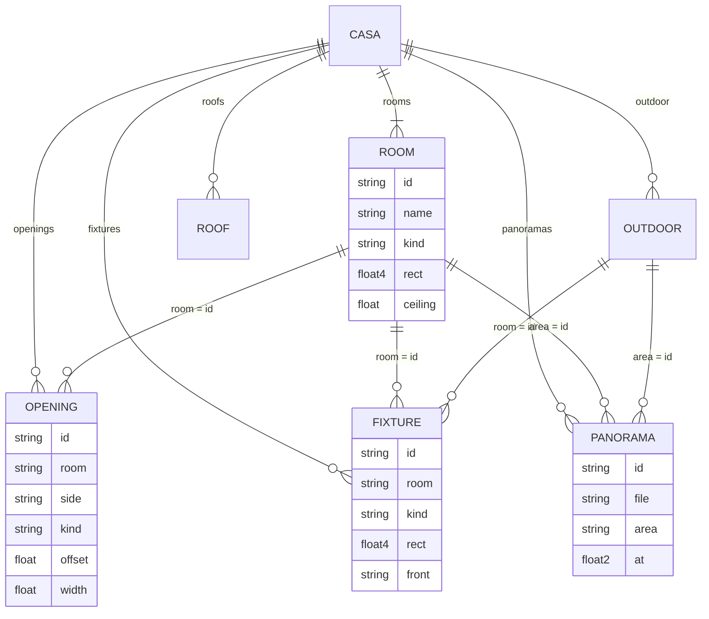

# Especificación

## 1. Propósito y alcance

Representar una casa existente como un modelo paramétrico editable, a partir de un único archivo de datos
(*casa.json*), y derivar de él una planta editable, un modelo 3D navegable, un visor de panorámicas ubicadas
en la planta y renders fotorrealistas.

Dentro del alcance: cuartos rectangulares (con partes para formas en L), muros derivados, vanos (puertas,
ventanas, arcos, portones), empotrados, muebles, exteriores, techos de dos y cuatro aguas, panorámicas
cilíndricas y render con Blender.

Fuera del alcance: muros diagonales o curvos, varios pisos, cálculo estructural, presupuesto, y cualquier
backend o almacenamiento compartido (cada visitante edita su propia copia en el navegador).

## 2. Requisitos funcionales

| ID | Requisito |
|---|---|
| RF-01 | La app carga `src/core/casa.default.json` y, si existe en `localStorage` una copia con `revision` igual o mayor, usa la copia. |
| RF-02 | Si la copia guardada tiene `revision` menor que el borrador, la app usa el borrador, respalda la copia en `casa-json-v1-respaldo-r<N>` y permite recuperarla con Deshacer. |
| RF-03 | Cada cambio se guarda en `localStorage` (`casa-json-v1`) y se puede deshacer (hasta 80 pasos, Cmd/Ctrl+Z o botón). |
| RF-04 | Los muros se derivan de los cuartos: muro compartido repartido por mitades entre cuartos separados ≤ 0.6 m, muro exterior de `defaults.wallThickness` en los lados sin vecino, sin muro entre partes del mismo cuarto ni en lados listados en `open`. |
| RF-05 | Un vano se define por cuarto, lado, `offset` y ancho; atraviesa el muro completo (incluida la mitad del vecino). Las puertas llegan al piso; las ventanas tienen repisa (`sill`, 0.9 m por defecto). |
| RF-06 | La validación informa traslapes entre cuartos (o partes), vanos que se salen de su lado y vanos que apuntan a un cuarto inexistente. |
| RF-07 | El editor de planta permite mover y redimensionar cuartos (ajuste 0.05 m, mínimo 0.5 m por lado), deslizar vanos dentro de su lado, mover muebles y puntos de foto, y agregar cuartos y vanos. Al mover un cuarto viajan con él sus partes, muebles y puntos de foto. |
| RF-08 | El visor 3D ofrece vistas predefinidas (maqueta, sección a 1.30 m, planta 3D), corte de sección de 0 a 3 m, capas conmutables y recorrido a pie con colisiones contra muros. |
| RF-09 | El visor de panorámicas proyecta la foto en un cilindro; si la foto no está disponible muestra un aviso en lugar de fallar. |
| RF-10 | La app permite copiar e importar *casa.json* (la importación exige un arreglo `rooms`), y fuera de un iframe descargar *casa.json* y `casa.glb`. |
| RF-11 | `tools/serve.py` sirve el repo sin caché y acepta `PUT /__save/<ruta>` solo dentro de `assets/`. |
| RF-12 | `tools/render/render_casa.py` renderiza las tomas pedidas desde `assets/modelo/casa.glb` y *casa.json* a `assets/renders/`. |
| RF-13 | `tools/pano_period.py` estima el periodo de 360° de cada panorámica y la focal `f = P / 2π`. |
| RF-14 | La galería de renders muestra `assets/renders/<toma>.jpg` y oculta las tomas cuya imagen no exista. |

## 3. Requisitos no funcionales

| ID | Requisito |
|---|---|
| RNF-01 | **Sin compilación**: HTML + módulos ES nativos; se sirve tal cual desde GitHub Pages o cualquier servidor estático. |
| RNF-02 | **Costo**: cero; hosting en GitHub Pages y dependencias por CDN público. |
| RNF-03 | **Privacidad**: fotos y panorámicas no se versionan (`.gitignore`); el sitio público no las incluye. |
| RNF-04 | **Seguridad local**: `serve.py` escucha solo en `127.0.0.1` y rechaza (403) escrituras fuera de `assets/`. |
| RNF-05 | **Portabilidad del núcleo**: `geometry.js` y `fixtures.js` no dependen de three.js ni del DOM. |
| RNF-06 | **Rendimiento**: el 3D se reconstruye solo cuando el modelo cambió (`dirty3d`) y la pestaña 3D está activa; razón de píxeles limitada a 2. |
| RNF-07 | **Tolerancia**: sin `localStorage` disponible la app funciona sin guardar; el render cae a CPU si no hay GPU Metal. |
| RNF-08 | **Unidades**: metros en todo el modelo; ángulos de techo en grados. |

## 4. Especificación por componente

### 4.1 Núcleo geométrico (`src/core/geometry.js`)

| Función | Entrada | Salida |
|---|---|---|
| `sideLine(rect, side)` | `[x0,z0,x1,z1]`, `'S'\|'N'\|'W'\|'E'` | `{axis, line, from, to, out}`; lanza error con un lado desconocido. |
| `roomRects(room)` / `cells(casa)` | cuarto / casa | Rectángulos del cuarto (principal + `parts`) / todas las celdas. |
| `area(rect)` / `roomArea(room)` | rectángulo / cuarto | m² (nunca negativo). |
| `roomHeight(casa, room)` | | `room.ceiling ?? defaults.ceiling`. |
| `wallColor(casa, room, side)` | | `wallColors[side] ?? wallColor ?? defaults.wallColor`. |
| `deriveWalls(casa)` | casa | `{walls, openings}`; cada muro `{x0,x1,z0,z1,y0,y1, room, side, axis, exterior, color}`. |
| `resolveOpenings(casa)` | casa | Vanos con `a`, `b` (rango sobre el muro), `sill`, `top`, `kindInfo`. Omite los de cuartos inexistentes. |
| `bounds(casa, {outdoor})` | | `[x0,z0,x1,z1]` de cuartos (y exteriores si `outdoor`). |
| `validate(casa)` | casa | Arreglo de mensajes en español; vacío si no hay problemas. |

Criterios de aceptación:

- **CA-01** Dado dos cuartos separados 0.15 m, cuando se derivan los muros, entonces hay dos piezas
  interiores de 0.075 m que se tocan, cada una con la altura de su cuarto.
- **CA-02** Dado un cuarto sin vecinos, cuando se derivan los muros, entonces sus lados libres son
  exteriores de `wallThickness` y se extienden ese grosor en las esquinas.
- **CA-03** Dado un cuarto con `parts` contiguas, entonces no hay muro entre la parte principal y la parte.
- **CA-04** Dado un lado en `open`, entonces ese lado no genera muro.
- **CA-05** Dada una puerta en un muro compartido, cuando se derivan los muros, entonces ambas mitades
  quedan cortadas con un dintel desde la altura de la puerta, y la banda del vano cubre el muro completo.
- **CA-06** Dada una ventana sin `sill`, entonces su repisa es 0.9 m; dada una puerta, su repisa es 0.
- **CA-07** Dado un tipo de vano desconocido, entonces se trata como `vano`.
- **CA-08** Dado un traslape, un vano fuera de su lado o un vano sin cuarto, `validate` devuelve un mensaje
  por cada caso; dado el borrador publicado, `validate` devuelve `[]`.

### 4.2 Orquestador (`src/app.js`)

- **CA-09** Dado un `localStorage` con `revision` menor que la del borrador, cuando carga la app, entonces se
  muestra la revisión nueva, la anterior queda en `casa-json-v1-respaldo-r<N>` y Deshacer la recupera.
- **CA-10** Dado un archivo JSON sin `rooms` como arreglo, cuando se importa, entonces la app muestra
  «No se pudo importar» y no cambia el modelo.
- **CA-11** Dada la app dentro de un iframe, entonces los botones de descarga quedan ocultos.

### 4.3 Servidor local (`tools/serve.py`)

CLI: `python3 tools/serve.py [puerto]` (por defecto 5173), escucha en `127.0.0.1`.

| Método y ruta | Respuesta |
|---|---|
| `GET /<archivo>` | Archivo estático con `Cache-Control: no-store`. |
| `PUT /__save/<ruta>` dentro de `assets/` | `201`, cuerpo = ruta relativa al repo (p. ej. `assets/modelo/casa.glb`); crea carpetas. |
| `PUT /__save/<ruta>` que resuelve fuera de `assets/` | `403`. |
| `PUT` a cualquier otra ruta | `404`. |

- **CA-12** Dado un `PUT /__save/../tests/x.txt`, entonces responde 403 y no crea el archivo.

### 4.4 Render (`tools/render/render_casa.py`)

```text
Blender -b --factory-startup -P tools/render/render_casa.py -- [--shots a,b] [--samples N] [--res WxH] [--preview]
```

| Argumento | Por defecto | Efecto |
|---|---|---|
| `--shots` | las 7 tomas | `fachada`, `aerea`, `maqueta`, `patio`, `sala`, `cocina`, `estudio`. |
| `--samples` | 256 | Muestras de Cycles (máximo 48 con `--preview`). |
| `--res` | `1920x1080` | Resolución (a la mitad con `--preview`). |
| `--preview` | apagado | Umbral adaptativo más alto y salida `<toma>-preview.png`. |

Entradas: `assets/modelo/casa.glb`, `src/core/casa.default.json`. Salida: `assets/renders/<toma>.png`. La toma
`maqueta` (`cutaway`) oculta techos y cielos rasos.

### 4.5 Periodo de panorámicas (`tools/pano_period.py`)

CLI: `.venv/bin/python tools/pano_period.py <imágenes...>`. Por cada imagen trabaja a escala 1/8 sobre la
magnitud del gradiente, busca cinco franjas del inicio en el resto de la imagen y acepta el periodo si al
menos dos candidatos con correlación > 0.5 coinciden en ±3 px. Escribe `tools/pano_period.json`:

```json
{ "foto.jpg": { "width": 12000, "height": 2000, "period": 9420, "votes": 4, "score": 0.81, "f": 1499.2 } }
```

Si no hay consenso: `"period": null`, `"votes": 0` y la lista `cands`.

- **CA-13** Dada una imagen sintética que se repite cada P px, entonces el periodo estimado está a ±16 px de P.
- **CA-14** Dada una imagen sin repetición, entonces `period` es `null`.

## 5. Esquema de *casa.json*

Todas las medidas en metros; rectángulos como `[x0, z0, x1, z1]` en planta (`x` a la derecha visto desde la
calle, `z` hacia el fondo, `z = 0` en la fachada). Lados: `S` (frente), `N` (fondo), `W` (izquierda),
`E` (derecha).

### 5.1 Raíz

| Campo | Tipo | Descripción |
|---|---|---|
| `version` | entero | Versión del formato (1). |
| `revision` | entero | Revisión de la planta; controla la migración de copias guardadas (RF-02). |
| `name` | texto | Nombre del modelo. |
| `units` | `"m"` | Unidades. |
| `notes` | texto | Notas libres del borrador. |
| `defaults` | objeto | `wallThickness`, `ceiling`, `doorHeight`, `wallColor`, `floor`, `ceilingFinish`. |
| `rooms` | arreglo | Cuartos (obligatorio para importar). |
| `openings` | arreglo | Vanos. |
| `fixtures` | arreglo | Empotrados, muebles y elementos exteriores. |
| `outdoor` | arreglo | Áreas exteriores. |
| `roofs` | arreglo | Techos. |
| `panoramas` | arreglo | Puntos de foto. |

### 5.2 Entidades

| Entidad | Campos obligatorios | Campos opcionales |
|---|---|---|
| Cuarto (`rooms[]`) | `id`, `name`, `kind`, `rect` | `parts` (rectángulos extra, sin muro entre ellos), `ceiling`, `floor` (`provenzal`, `parquet`, `hidraulico`, `ceramica`, `cemento`), `ceilingFinish` (`tablilla`, `vigas`, `blanco`), `wallColor`, `wallColors` (por lado), `open` (lados sin muro), `confidence` (`alta`, `media`, `baja`). |
| Vano (`openings[]`) | `id`, `room`, `side`, `kind`, `offset`, `width` | `height`, `sill` (solo ventanas), `part` (índice del rectángulo: 0 = principal, 1.. = `parts`), `reja` (reja en ventanas), `glass` (vidrio en hojas de puerta). `arch` aparece en los datos pero no lo lee el código actual. |
| Mueble (`fixtures[]`) | `id`, `room`, `kind`, `rect` | `front` (lado de uso; `S` por defecto), `height`, `y0`, `style` (tapias: `liso`, `teja`, `enredadera`), `color` (algunos sofás). `room` puede ser un cuarto, un área exterior o `lote` (perímetro). |
| Exterior (`outdoor[]`) | `id`, `name`, `rect`, `surface` (`zacate`, `provenzal`, `hidraulico`, `cemento`) | `roof` (`true`: techado con columnas). |
| Techo (`roofs[]`) | `id`, `name`, `kind` (`hip` cuatro aguas, `gable` dos aguas), `rect` (contorno de muros) | `pitch` (grados, 18), `overhang` (0.7), `ridge` (`x`/`z`, solo `gable`), `base` (altura sobre la línea de muro, 2.8). |
| Panorámica (`panoramas[]`) | `id`, `file` (en `panoramas-web/`), `name`, `area` (id de cuarto o exterior), `at` (`[x, z]`) | `focal`, `sourceWidth` (si no están, `f = alto`). `heading` aparece en los datos pero no lo lee el código actual. |

Tipos de vano (`OPENING_KINDS`): `puerta`, `reja`, `porton`, `vano`, `arco`, `ventana`. Tipos de mueble: ver
`FIXTURE_KINDS` en `src/core/fixtures.js` (capas `empotrados`, `muebles`, `exterior`).



### 5.3 Ejemplo reducido (genérico)

```json
{
  "version": 1,
  "revision": 1,
  "name": "Ejemplo",
  "units": "m",
  "defaults": { "wallThickness": 0.15, "ceiling": 2.5, "doorHeight": 2.1,
                "wallColor": "#ecebe4", "floor": "ceramica", "ceilingFinish": "blanco" },
  "rooms": [
    { "id": "sala", "name": "Sala", "kind": "sala", "rect": [0, 0, 5, 4], "confidence": "media" },
    { "id": "cocina", "name": "Cocina", "kind": "cocina", "rect": [5.15, 0, 8, 4],
      "parts": [[5.15, 4, 6.5, 5]], "wallColors": { "E": "#dfe6ef" } }
  ],
  "openings": [
    { "id": "entrada", "room": "sala", "side": "S", "kind": "puerta", "offset": 2, "width": 0.9 },
    { "id": "paso", "room": "sala", "side": "E", "kind": "arco", "offset": 1, "width": 1.2 },
    { "id": "v-cocina", "room": "cocina", "side": "N", "kind": "ventana", "offset": 1.6, "width": 1, "sill": 1.1 }
  ],
  "fixtures": [
    { "id": "sofa-1", "room": "sala", "kind": "sofa", "rect": [0.2, 3, 2.4, 3.9], "front": "S" },
    { "id": "mueble-1", "room": "cocina", "kind": "mueble", "rect": [7.4, 0.2, 8, 3.8], "front": "W" }
  ],
  "outdoor": [
    { "id": "jardin", "name": "Jardín", "rect": [-1, -4, 9, -0.3], "surface": "zacate" }
  ],
  "roofs": [
    { "id": "techo", "name": "Techo", "kind": "hip", "rect": [-0.15, -0.15, 8.15, 4.15], "pitch": 18, "overhang": 0.7 }
  ],
  "panoramas": [
    { "id": "p01", "file": "sala.jpg", "name": "Sala", "area": "sala", "at": [2.5, 2] }
  ]
}
```

## 6. Trazabilidad

| Requisito | Módulo | Prueba |
|---|---|---|
| RF-04 | `geometry.js` `deriveWalls` | `tests/geometry.test.mjs` (muro compartido, exteriores, partes, `open`) |
| RF-05 | `geometry.js` `resolveOpenings`, `cutOpening` | `tests/geometry.test.mjs` (puertas y ventanas, corte en muro compartido) |
| RF-06 | `geometry.js` `validate` | `tests/geometry.test.mjs` (traslapes, vanos fuera, borrador válido) |
| RF-01, RF-02, RF-03, RF-10 | `app.js` | Sin prueba automatizada (manual) |
| RF-07 | `plan.js` | Sin prueba automatizada (manual) |
| RF-08, RF-14 | `scene3d.js`, `app.js` | Sin prueba automatizada (manual) |
| RF-09 | `pano.js` | Sin prueba automatizada (manual) |
| RF-11 | `tools/serve.py` | `tests/test_tools.py` `ServeTest` |
| RF-12 | `tools/render/render_casa.py` | Sin prueba automatizada (requiere Blender) |
| RF-13 | `tools/pano_period.py` | `tests/test_tools.py` `PanoPeriodTest` |
| Integridad de *casa.json* | `casa.default.json` | `tests/test_tools.py` `CasaDefaultTest`, `tests/geometry.test.mjs` |
